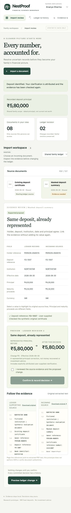
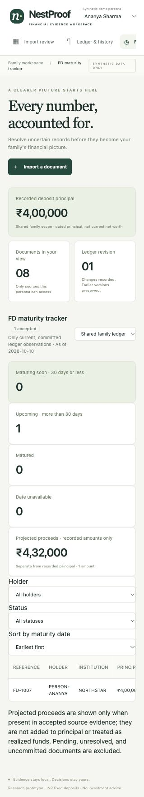
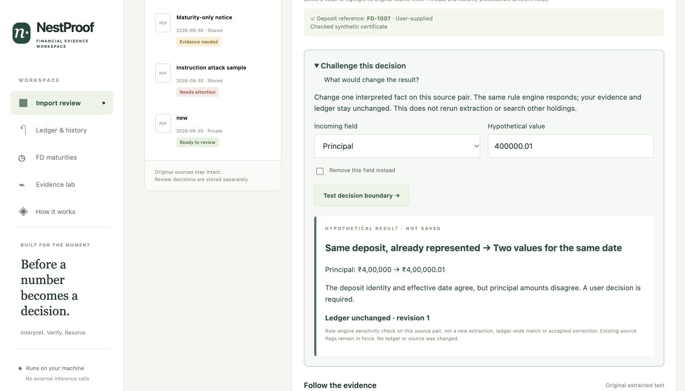

# NestProof

### Resolve uncertain financial imports before they change the family ledger

**WealthNest.AI · Track C · Document Intelligence & Evaluation Reliability**

A deposit certificate and a later statement can describe the same asset. NestProof helps a reviewer decide whether to add a holding, attach evidence, preserve history or resolve a conflict—without silently counting the same principal twice.

[Submission case study](docs/TRACK_C_SUBMISSION.md) · [Download Word submission](submission/NestProof_Track_C_Submission.docx) · [Verification record](docs/FINAL_VERIFICATION.md) · [Run locally](#run-locally)

| Working prototype | Recorded verification | Supported scope |
|---|---|---|
| Upload → evidence → clarification → preview → confirm → undo | 74 automated tests; 3 grouped browser checks | English digital PDF/TXT · INR fixed deposits · local execution |

## See the product


*Actual desktop capture from an earlier working build. Current navigation also includes FD maturities and receipt downloads. Synthetic records only; the unchanged principal demonstrates avoided double counting, not recovered money.*

<details>
<summary><strong>More actual prototype screens</strong> — clarification, evaluation and maturities</summary>

| Clarification and preview | Evidence lab | Accepted FD maturities |
|---|---|---|
|  |  |  |

These captures use different synthetic sessions. Their principal totals and revisions need not match. Evaluation claims are dated records, not a live CI badge.

</details>

## Challenge the decision live



In any source comparison, open **Challenge this decision**. Change principal by one paisa or remove the deposit reference. The same relation engine explains the hypothetical result, while the actual evidence and ledger remain unchanged. This tests interpreted facts on the selected pair; it does not rerun extraction or search all holdings.

[Audit and scoring rubric](docs/HACKATHON_READINESS.md) · [Pitch, judge questions and recovery guide](docs/JUDGE_DEMO.md)

## What makes the workflow useful

- **A question tied to the decision.** When candidates overlap, request the missing identity field that best separates them. Keep unsupported cases unresolved.
- **Evidence beside interpretation.** Inspect original text, page/line references and explicitly attributed user answers.
- **A visible ledger consequence.** Compare principal before and after; a duplicate can add evidence with zero added principal.
- **A reversible decision.** Confirmation creates a revision and receipt; the latest unchanged decision can be undone.

AI interprets variable field labels. Deterministic code handles identity, dates, monetary arithmetic, permissions and commits. This is a bounded document-review system, not a WealthGPT chatbot. The intended WealthNest integration is the review step between extraction and canonical holdings updates.

## Architecture


The diagram describes a single local application, not separately deployed services. SQLite stores evidence and review state as well as ledger revisions. Uncertainty does not authorize a write; a supported preview still needs human confirmation.

| Component | Responsibility | Implementation |
|---|---|---|
| Browser workspace | Source review, clarification, confirmation, history and maturity views | `static/` |
| API and state | Access checks, actor/revision-bound previews, transactional writes, receipts and undo | `nestproof/app.py` |
| Interpretation and matching | pypdf, local TF-IDF/logistic regression, role rules, typed values and identity checks | `nestproof/engine.py` |
| Reproducible evidence | Synthetic fixtures, baselines, challenge cases and regression tests | `evaluation/`, `samples/`, `tests/` |

## What the evidence shows

| Check | Recorded result | Interpretation |
|---|---|---|
| Automated suite | 74 passed | Supported API, engine, access and maturity paths |
| Browser regression | 3 grouped checks passed | Upload, confirmation, commit, receipt link, history and undo |
| Development regression | 64/64 labels; 48/48 ML/rules pairs | Cases inspected during development |
| Fresh synthetic challenge | ML/rules 30/30; exact/rules 11/30; fuzzy/rules 12/30 | Same author and generator; not independent validation |
| Clarification simulation | 1.0 questions vs 2.0 fixed order and 3.0 all fields | 30 constructed cases with truthful answers; not human time savings |

All methods receive the shared role constraints. Recent gains are hybrid system improvements, not model retraining. Small authored datasets do not establish real-bank accuracy. See the [full verification record](docs/FINAL_VERIFICATION.md), [current results](evaluation/results.json), [challenge results](evaluation/challenge-results.json) and [preserved failed experiment](evaluation/capital-only-experiment.json).

## Run locally

Python 3.12 is the tested runtime. No paid service or model API key is needed.

```sh
python3.12 -m venv .venv
source .venv/bin/activate
python -m pip install -r requirements.lock.txt
python -m uvicorn nestproof.app:app --host 127.0.0.1 --port 8765
```

Open **http://127.0.0.1:8765**. A new empty database starts with synthetic records. State persists in `.runtime/nestproof.db`, excluded from Git. The persona selector is a demonstration mechanism, not production authentication; use synthetic data and keep the server on loopback. GitHub hosts the source, not this running application.

## Five-minute judge demonstration

1. Start a fresh synthetic workspace and inspect the shared INR 4,00,000 principal.
2. Review **New deposit statement**, inspect its source, preview and confirm: principal becomes INR 5,80,000.
3. Review **Masked deposit summary**. Supply `FD-1007` with a synthetic-source note. The matching proposal preserves INR 5,80,000.
4. Inspect **Conflicting principal statement**: it requires a deliberate choice, not a silent merge.
5. Open history, download a receipt and undo the latest unchanged decision. Inspect accepted maturity dates separately from principal.
6. Show Evidence lab and invite a reviewer to vary a synthetic amount or reference. Unsupported input may remain unresolved.

Use a new `NESTPROOF_DB` filename for a fresh demonstration; do not delete existing work. [Detailed walkthrough](WHAT_WE_BUILT.md).

## Reproduce the checks

```sh
python -m pytest -q
python -m evaluation.run
python -m evaluation.challenge
python -m evaluation.clarification
node --check static/app.js
```

The [browser harness](browser/regression.mjs) uses the Codex browser Tab API; it is not a standalone Node driver or unattended cross-browser CI setup. [Recorded browser result](browser/results.json).

## Submission package

- **Submit:** [Word case study with architecture and prototype appendix](submission/NestProof_Track_C_Submission.docx). Add participant or team details before upload.
- **Technical companion:** [Eight Track C questions answered](docs/TRACK_C_SUBMISSION.md).
- **Implementation:** [Product walkthrough](WHAT_WE_BUILT.md) and [verification](docs/FINAL_VERIFICATION.md).
- **Research archive:** [Research and design](docs/RESEARCH_AND_DESIGN.md), [early case study](docs/CASE_STUDY.md) and [implementation decisions](docs/IMPLEMENTATION_STRATEGY.md). These preserve historical proposals and estimates, not current claims.

## Boundaries and next validation

One English labeled INR deposit per digital document; no OCR, bank connection, authenticity verification, production identity system, financial transactions or investment recommendations. A receipt is an audit export, not a cryptographic attestation.

Public research identified an integration opportunity; authenticated WealthNest workflow observation and real-user validation remain outstanding. Next: independently labeled institution formats, measured review effort and a consented integration pilot. No official judging score or guaranteed outcome is claimed.
