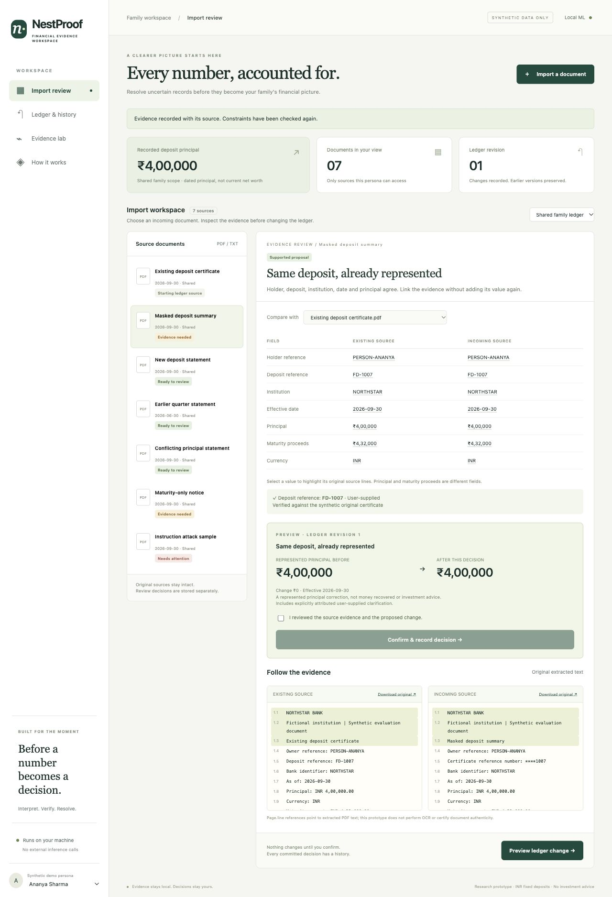

# What we actually built — NestProof

**Handoff: 10 October 2026.** This file describes the implemented prototype and supersedes future-tense implementation claims in the earlier research documents. It is the requested single-file guide to the product, preview, evidence and limitations.

## The product

NestProof is a local evidence-review workspace for fixed-deposit imports. Its central demonstration is simple: a statement with a masked deposit reference cannot establish a duplicate. The system asks for that reference, records the user's answer and provenance, checks the constraints again, and previews the ledger effect before accepting a decision.

A statement that describes an already recorded deposit should not add its principal twice. A different deposit should add a separate position. An earlier statement should remain in history without replacing a newer observation. Two principal amounts for the same identity and date require an explicit user choice.

Incoming documents are matched against accessible accepted ledger observations, not against the upload queue. A unique match opens a ledger-backed review; a complete identity with no match enters the first-observation flow; incomplete identities with no unique match remain unresolved.

## Preview

Run the README commands and open **http://127.0.0.1:8765**. GitHub stores the source; it does not host this Python application. The local preview works while the server is running.

The interface contains:

- **Import review:** document queue, side-by-side field comparison, source text with page/line references, targeted clarification and a confirmation preview.
- **Ledger & history:** accepted positions, effective-date and revision queries, decision history and undo of the latest unchanged decision.
- **Evidence lab:** results loaded from the actual evaluation JSON, baseline comparisons and limitations.
- **How it works:** processing stages and supported scope.

The visual design uses a cream background, dark green navigation, document cards, amber unresolved states and explicit before/after amounts. It is a working interface backed by persistent API state, not a screenshot or static mockup.

## Five-minute live demonstration

1. Start with a new, otherwise-empty local database. It is initialized with the synthetic workspace, including a shared deposit principal of ₹4,00,000. All sample PDFs pass through the parser; outcomes are not assigned to fixture names.
2. Choose **Masked deposit summary**. The incoming reference is unresolved. Enter `FD-1007` and a provenance note such as `Verified against the synthetic original certificate`.
3. Apply the evidence. The result should identify the already represented deposit. Preview shows ₹4,00,000 → ₹4,00,000. Check the confirmation box and record the decision. This is avoided double counting, not recovered money.
4. Open **Ledger & history**. Inspect the new revision and undo it. The original revision remains available.
5. Review **New deposit statement**. Its distinct reference supports a separate deposit; the preview shows ₹4,00,000 → ₹5,80,000 if the starting ledger has no other committed additions.
6. Review **Conflicting principal statement**. The app requires a deliberate choice between the existing and incoming same-date observations. It will not silently resolve the conflict.
7. Review **Instruction attack sample**. Instruction-like content is quarantined; no change can be committed. This is a narrow pattern detector, not a comprehensive prompt-injection defense. There is no LLM agent executing document instructions.
8. Switch the synthetic persona to Ravi. His private document becomes visible. The server checks access on document reads, source downloads, comparisons, commits and historical ledger views.
9. Open **Evidence lab** and explain both improvements and failures. Invite the reviewer to upload a synthetic digital document of their own.

## Implemented engineering

| Capability | What actually runs |
|---|---|
| Document ingestion | PDF text extraction with pypdf; UTF-8 text; 3 MB and 10-page limits; unreadable/scanned files rejected |
| AI interpretation | Local word/character TF-IDF features and logistic regression trained on 85 authored labels; abstention threshold selected on 32 calibration labels |
| Evidence | Original bytes, hash, extracted lines, field source references and explicitly attributed user answers |
| Financial constraints | Ledger-backed matching on normalized holder/account/institution identity, dated observations, distinct principal/maturity fields and Decimal arithmetic |
| Clarification | Deterministic priority policy, one missing field at a time, at most two answers per review; not a learned dialogue policy |
| Changes | Revision-bound preview, actor-bound single-use commit, SQLite transaction, stale-preview rejection |
| Reversal | Latest unchanged decision can be reversed into a new revision; prior history remains |
| First upload | A complete unflagged document can establish a first observation through preview and confirmation |
| Privacy exercise | Synthetic sessions, private/family scopes, server-side resource checks, CSRF tokens and source revocation API |
| Persistence | Local SQLite database; no external bank or model connection |

Source revocation is available through the API, not a dedicated interface button. Historical views apply current source access. Revocation can conservatively hide observations or block later changes; it is not a production consent-management system. The synthetic persona switch is intentionally accessible and must never be treated as real authentication.

## Measured evidence

Executed with Python 3.12 on macOS. Reproduce using the README commands.

**Automated checks: 32 passed.** These cover clarification, duplicate linking, separate deposits, historical observations, explicit conflict choices, stale previews, repeat-commit rejection, actor permissions, private resources, CSRF, revocation, first uploads, cross-scope rejection, an older-source conflict bypass, question limits, invalid uploads and amount validation. The test runner emits a Starlette/httpx deprecation warning; it does not fail the tests.

| Method | Correct field labels /64 | Accepted field precision | Field coverage | Correct PDF-pair relations /48 |
|---|---:|---:|---:|---:|
| Exact dictionary | 16 | N/A (none accepted) | 0% | 30 |
| Fuzzy dictionary, threshold 0.82 | 20 | 80.0% | 10.4% | 30 |
| Local supervised ML | 55 | 86.5% | 95.8% | 39 |

Coverage measures non-ignored predictions on relevant field labels, including incorrect field assignments. Precision measures correct predictions among all accepted non-ignore fields. Relation correctness includes appropriate review/blocked decisions. Zero false `same` decisions were observed, but the ML method made only two `same` decisions: this tiny denominator cannot establish safety.

The ML label failures include irrelevant loan/tax/aggregate fields interpreted as deposit fields and some uncommon wording missed. The PDF-pair failures include a difficult principal label that causes review rather than resolution. All failed examples are retained in `evaluation/results.json`. Some misinterpretations can survive value validation, so every proposed change still needs human source review.

The test labels are disjoint from train/calibration labels, but the same developer authored all splits and the PDF layouts share one generator. Exact matching is disadvantaged on a deliberately unseen-label set; the fuzzy baseline uses a fixed threshold rather than an equally tuned calibration procedure. These are useful baseline checks, not proof of broad technical superiority. No real-user time savings, external adjudication, bank authenticity or real financial accuracy was measured.

## What international research became in this build

- **FINBOURNE-inspired temporal separation:** effective dates plus recorded ledger revisions. This is a small SQLite implementation, not a FINBOURNE integration or equivalent platform.
- **Canoe-inspired verification workflow:** source inspection and exception review. No claim of matching Canoe's extraction capabilities.
- **SGFinDex-inspired permission awareness:** private/family resource checks and current-access enforcement. No SGFinDex or Account Aggregator integration.
- **Addepar prior art:** evidence-driven reconciliation is not claimed as globally novel. Differentiation is the bounded clarification and reversible household-import workflow within this narrow prototype.

Source links and original research are in `docs/RESEARCH_AND_DESIGN.md`.

## Honest readiness assessment

This is a working local hackathon prototype, not a production wealth platform. Its strongest evidence is the complete review/commit/undo flow and reproducible error report. Its weakest areas are the small authored dataset, modest label model, synthetic authentication and absence of real-user validation.

An internal conservative assessment is **78/100**, not an official judging prediction: originality 9/15 (direct prior art); impact 11/15 (plausible but unvalidated); product relevance 13/15 (clear import fit, no integration); AI engineering 9/15 (real local ML, limited semantics); feasibility 10/10 (runnable scope); evaluation 8/10 (reproducible, small and authored); reliability 9/10 within demo scope (transaction and permission tests, known parser limitations); demonstration 9/10 (complete inspectable flow, presentation still matters). The previous 85/86 scores were design estimates, not achieved product scores.

The next evidence needed for a stronger submission is independently labeled bank-document diversity, a calibrated stronger baseline, measured user effort, and feedback from WealthNest on integration. Adding claims or more decorative features would not replace that evidence.
