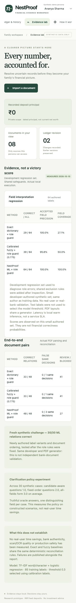

# Final verification and experiment record

10 October 2026. The prototype focuses on Track C document intelligence, not WealthGPT.

| Check | Executed result |
|---|---|
| API/engine tests | 55 passed; one dependency deprecation warning |
| JavaScript syntax | Passed |
| Browser regression | 3 grouped checks: upload/review, explicit preview confirmation/commit, receipt link/history/undo |
| Development labels | ML plus shared role constraints 64/64 |
| Development pairs | ML plus shared role constraints 48/48; exact and fuzzy plus same constraints 33/48 |
| Fresh synthetic challenge | ML 30/30; exact 11/30; calibrated fuzzy 12/30 |
| Clarification policy simulation | Candidate-aware 1.0 questions; fixed order 2.0; all-fields 3.0 |

The original 39/48 pair failures shared missed principal wording. Fixing that alone produced 47/48 but introduced a false same-deposit result when maturity proceeds were missed. `evaluation/capital-only-experiment.json` preserves this failed iteration. Shared compositional role rules now recognize invested/deposited capital, currency/denomination and maturity/expiry proceeds. The test for inconsistent maturity prevents hiding that conflict as a duplicate.

The ML model itself was not retrained. The system improvement is hybrid: deterministic role knowledge plus local ML. Every baseline receives the same role constraints. Role-rule matches return a rule score, not a financial correctness probability.

`evaluation/challenge.py` was authored after the role changes and run without subsequent engine tuning. The source and engine hashes are in its result file. It is still authored by the same developer, shares the PDF generator, and covers a narrow schema. Perfect results on these small sets are not independent real-world validation.

`evaluation/clarification.py` models truthful answers and deliberately constructed candidate groups with a single distinguishing field. It evaluates the actual field-selection helper but not human comprehension, latency, wrong answers or cases requiring multiple distinguishing fields. No real-user study has been run.

The decision receipt was also downloaded successfully through the actual browser interface after the scripted checks.



## Reproduce

```sh
python -m pytest -q
python -m evaluation.run
python -m evaluation.challenge
python -m evaluation.clarification
node --check static/app.js
```

The browser harness is `browser/regression.mjs`. It uses the Codex browser Tab API, not a standalone Node browser driver. Against a fresh synthetic database and an Ananya session, import the module in the browser tool runtime and invoke `regression(tab, absolutePathToSamplesNewPdf)`. `browser/results.json` records the completed run. It is not an unattended cross-browser CI setup.

For an isolated demonstration use a new `NESTPROOF_DB` path. Do not delete or reset user work. Only run on loopback with synthetic data.

## Production gates still open

Independent labeling and real-world document diversity; real-user task study; actual WealthNest workflow validation; production identity and encrypted storage; OCR and broader layout coverage; robust parser isolation and load testing. These are not represented as completed.
