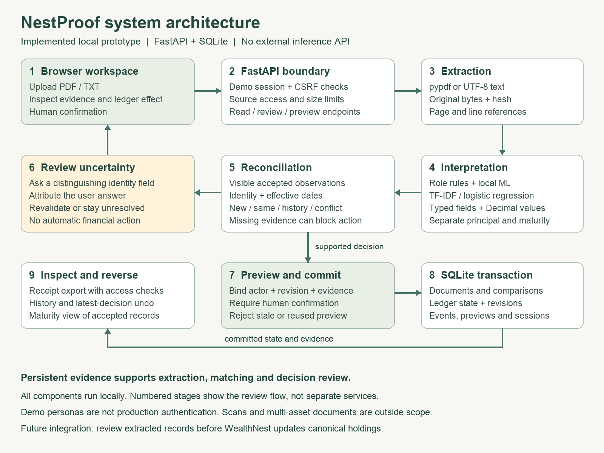
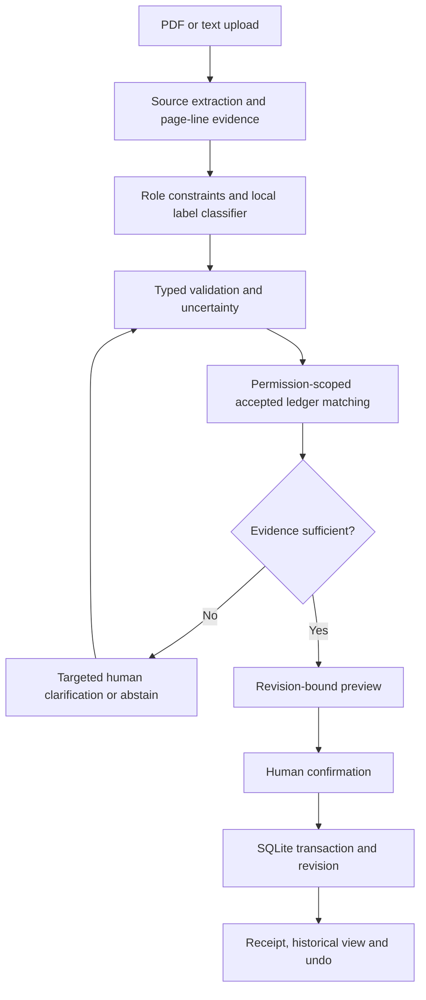

# NestProof — resolve uncertain imports before they change the family ledger

**Track C: Document Intelligence + Evaluation & Reliability.** Working local prototype, 10 October 2026. NestProof is not a WealthGPT chatbot. The challenge offers several directions; this submission deliberately solves one bounded problem.

**Submission files:** [Word case study with visual appendix](../submission/NestProof_Track_C_Submission.docx) · [GitHub repository](https://github.com/Ananya6Daitkar/Wealthiest). The Word case study follows the five deliverable sections; this technical companion answers the eight Track C questions.

## 1. What problem did we identify?

A household may upload a deposit certificate and a statement describing the same asset. Masked references, unfamiliar field labels, different statement dates and confusion between principal and maturity proceeds can make it unsafe to decide whether to add a new position, attach evidence, preserve history or flag a conflict.

The opportunity is the transition from extracted document fields to an accepted ledger decision. This is a reasoned integration hypothesis, not a verified bug in WealthNest's authenticated product. Research examined public materials; firsthand workflow observation and user validation remain outstanding.

## 2. Why is AI appropriate?

Field labels vary beyond an exact dictionary. A small local classifier combines word/character TF-IDF with logistic regression to interpret label variants. Explicit role rules separate principal, maturity proceeds and currency and exclude loan/tax/aggregate fields. All values are copied from source text and validated; no model invents amounts.

AI assists interpretation. Identity checks, dates, arithmetic, permission checks and commits use deterministic code. A rules-only product is a meaningful baseline, not a straw man. On a fresh synthetic challenge the exact/rules baseline resolved 11/30 relations correctly, calibrated fuzzy/rules 12/30, and ML/rules 30/30. This small developer-authored experiment supports usefulness within the narrow scope, not universal superiority.

## 3. What does the system do?

Upload a digital PDF or text file → inspect source-bound fields → match against accepted records → ask for decision-relevant missing evidence → recheck constraints → preview the ledger effect → human confirmation → transactional commit → downloadable receipt and reversible history.

When multiple deposits match, the system requests the missing identity field that best separates candidates. Answers remain visibly user-supplied. Unresolved cases are permitted to stay unresolved. A maximum of two accepted answers is used per supported review path; if the first disambiguating answer still cannot identify a unique deposit, clearer evidence is requested.

**Positioning:** “The smallest useful clarification, with evidence you can inspect and a decision you can reverse.” This is the distinguishing workflow; global novelty is not claimed. Reconciliation and document verification have established prior art.

## 4. What data does it need?

Current scope: synthetic, English, labeled digital fixed-deposit documents; INR; one deposit per source. Model training uses 85 authored labels and 32 calibration labels. No real personal financial information or paid inference API is needed. Source lines, hashes, extracted facts, answers, accepted observations and revisions are stored locally.

A real integration would need consented diverse institution formats, independently adjudicated field/relationship labels, real authorization, retention controls and failure monitoring. None is represented as already acquired.

## 5. What is the architecture?

FastAPI serves the API and vanilla JavaScript frontend. SQLite serializes writes. Previews bind to actor, evidence version and ledger revision; stale or repeated commits fail. Source access is checked again at commit and receipt export. This is a local prototype, not WealthNest integration or production authentication.

## 6. How do we evaluate it?

- **64 automated tests pass**, including permission boundaries, stale state, conflict handling, receipt access and typed financial roles.
- A reusable browser regression executed upload, preview gating, commit, receipt-link availability and undo: **3 grouped checks passed**.
- Original development regression: **64/64 label classifications and 48/48 PDF-pair relations correct** after iterative fixes. These cases informed development and are not independent validation.
- Fresh developer-authored challenge: **30/30 ML/rules relations correct**, versus 11/30 exact/rules and 12/30 fuzzy/rules. Three wording variants, reversed field order/capitalization and ten conditions; same author and PDF generator. No tuning followed the first run. No real-bank accuracy claim.
- Clarification simulation: **1.0 questions** for candidate-aware selection, **2.0** for fixed order and **3.0** for asking all identity fields across 30 constructed cases. Truthful oracle answers and one distinguishing field are assumed; these are not measured human savings.

All scripts, hashes, detailed outputs and failed intermediate results are included. A capital-only improvement briefly introduced a false same-deposit decision; that failed experiment is preserved and a regression test now covers the interaction with maturity extraction.

## 7. What could go wrong?

Misleading labels, multiple assets in a source, unsupported layouts, scans, forged documents, incorrect user answers, shared-source revocation and unmodeled context can defeat the prototype. Confidence scores are not probabilities of financial truth. A high synthetic score does not establish production safety. Similarities between developer-authored datasets limit external validity.

A receipt is a local audit export, not a cryptographic attestation. Synthetic persona switching is not authentication. Pattern-based quarantine is not comprehensive prompt-injection protection. The system does not conduct transactions or provide investment advice.

## 8. How do we make it reliable?

Keep evidence, model interpretation and user assertions separate. Validate roles and amounts, abstain on missing/contradictory evidence, scope matching to accepted visible records, require confirmation, reject stale decisions, preserve revisions and allow undo. Recheck current permissions even for historical receipts. Run regression tests and inspect failures rather than optimizing a headline score.

Before deployment: independently labeled document pilots, measured user tasks, appropriate identity/storage controls and WealthNest engineering review. Proposed integration point: a review step after document extraction and before canonical holdings updates. WealthGPT could later consume accepted observations and provenance, but no chatbot or retrieval integration is implemented.

## Judge-controlled demonstration

1. Import a synthetic PDF through the actual interface.
2. Accept the distinct new deposit: shared principal moves from ₹4,00,000 to ₹5,80,000.
3. Open the masked statement with two possible deposits. Supply FD-1007 with a source note. Preview remains ₹5,80,000: evidence is attached without adding its value twice.
4. Show a conflicting amount or instruction-like document that cannot silently change the ledger.
5. Inspect history, download a decision receipt and undo the latest unchanged decision.
6. Let the reviewer edit a synthetic amount/reference/date and upload it. Unsupported evidence may remain unresolved; do not promise every arbitrary input will parse.
7. Show the Evidence lab and its limitations alongside the result.

**Submission evidence:** source code, architecture above, working interface, sample PDFs, evaluation framework, original/failed/final results and reusable browser check. No win, shortlist or official score is guaranteed.
